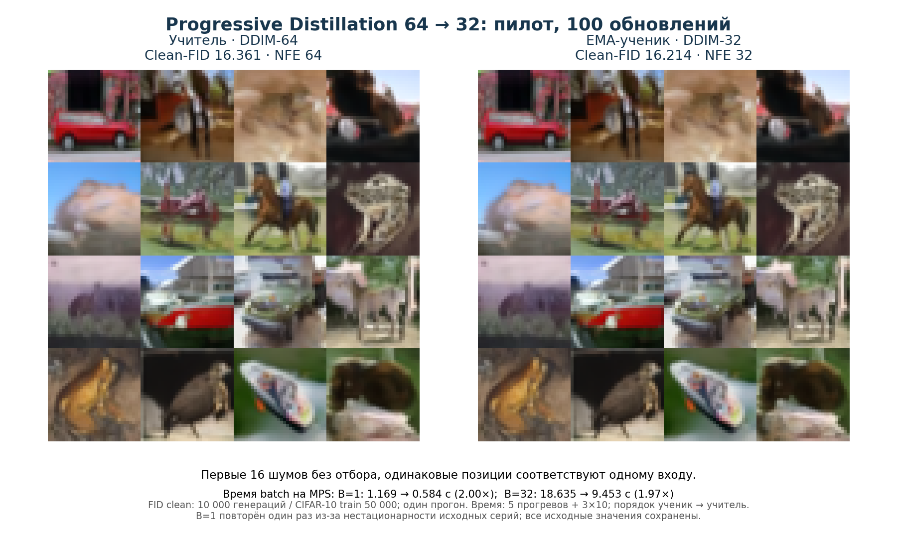

# Дистилляция диффузионных моделей

Этап 1: CIFAR-10 32×32, `google/ddpm-cifar10-32`, Progressive Distillation 64 → 32. Учитель заморожен, ученик имеет ту же U-Net и инициализируется его весами. Обучается средний epsilon MSE по аналитической цели из двух переходов учителя.

## Материалы

- [Ноутбук с выполненными ячейками](stage1.ipynb) — основной ход работы.
- [Метрики CSV](results/metrics.csv), [протокол и исходные измерения JSON](results/metrics.json).
- `src/diffusion_distill/` — алгоритмы, обучение и оценка.
- `configs/` — источники данных, весов и файлов метрики.

Отчёт и учебник хранятся локально в `output/pdf/`.

## Результаты

Apple M5 / MPS, FP32. Выполнен пилот дистилляции 64 → 32: 100 обновлений ученика из весов учителя, batch=2, AdamW lr=1e-5. Время дообучения — 35.807 с. Для оценки использованы EMA-веса.

| Метрика | Учитель DDIM-64 | EMA-ученик DDIM-32 |
|---|---:|---:|
| Clean-FID ↓ | 16.361 | 16.214 |
| NFE | 64 | 32 |
| Время batch=1, среднее ± std | 1.169 ± 0.008 с | 0.584 ± 0.004 с |
| Время batch=32, среднее ± std | 18.635 ± 1.259 с | 9.453 ± 0.944 с |

Отношение времени учителя к ученику: 2.00× при B=1 и 1.97× при B=32.



FID: по 10 000 генераций из одинаковых сохранённых шумов, seed 20261104, Clean-FID `clean` относительно CIFAR-10 train50k.

## Запуск

```bash
python3 -m venv .venv
.venv/bin/python -m pip install -e '.[notebook]'
.venv/bin/python -m ipykernel install --prefix .venv --name diffusion-distill --display-name 'Python (gen-cv .venv)'
```

## Источники и протокол

- [Модель Google](https://huggingface.co/google/ddpm-cifar10-32): лицензия весов Apache-2.0, ревизия закреплена в `configs/model.json`.
- [CIFAR-10](https://www.cs.toronto.edu/~kriz/cifar.html): 50 000 train / 10 000 test. Отдельная лицензия исходных изображений на странице явно не указана; её нельзя подменять лицензией весов. Архив зеркала сверяется с официальным MD5; источник и ревизия в `configs/dataset.json`.
- [Progressive Distillation](https://arxiv.org/abs/2202.00512): реализация адаптирована к выбранному DDPM. Исходная epsilon-параметризация и beta schedule сохранены. DDIM64 `leading`: 945,930,…,0,−1; студент использует каждую вторую вершину, включая чистый конец. Eta=0, промежуточный clipping выключен.
- [Clean-FID](https://github.com/GaParmar/clean-fid): `clean-fid==0.1.35` и совместимая `scipy==1.17.1`; контрольные суммы файлов метрики в `configs/metric_assets.json`.
